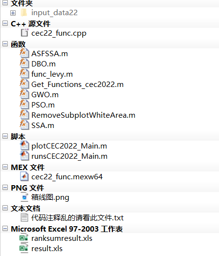
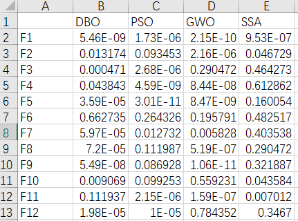
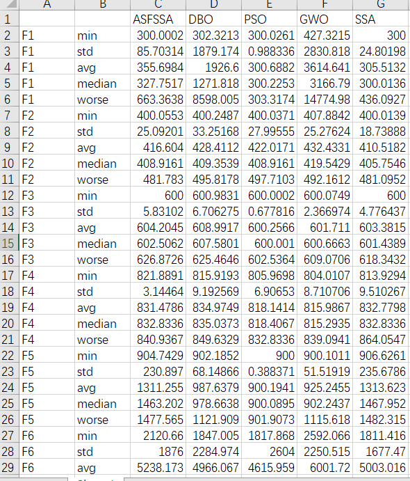
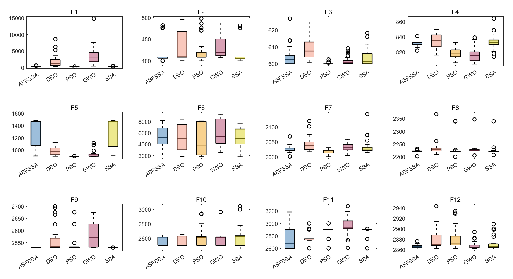

# CEC2022 Function Set Optimal Value, Average, Standard Deviation, Worst Value, Median, Kruskal-Wallis Test, Boxplot, Common Indicators for Intelligent Optimization Algorithms, and One-Click Export to Excel

Previously, we published a guide on how to use the CEC2005 function set for intelligent algorithm metrics with one-click statistics. However, many colleagues have inquired about how to call other function sets. Today, we will take the CEC2022 function set as an example to demonstrate this.

To highlight the effectiveness of improving intelligent optimization algorithms, it is common to compare these improved algorithms with others.

In some journal papers, you often see a very large table that statistically measures each algorithm's average, standard deviation, optimal value, worst value, and median values, such as:

Some papers also compare the difference between improved algorithms and their counterparts through rank sum tests, for example:

Other papers may present box plots to more intuitively display results, for instance:

However, if you had to manually run code over and over again to perform these tasks, even superheroes would probably not do it!

Today, we will use MATLAB tools to teach everyone how to directly complete the statistical analysis and export the Excel table while drawing a box plot.

The process of algorithm replacement is very simple; just replace the algorithm name! The test set replacement is also straightforward!

This session takes the Adaptive Spiral Flight Sparrow Search Algorithm (ASFSSA) (click the link to access, which can be freely obtained) as an example, comparing it with the Beetle Optimization Algorithm, Sparrow Optimization Algorithm, Particle Swarm Optimization Algorithm, and Grey Wolf Optimization Algorithm.

Each algorithm will be run 30 times in the CEC2022 function and tested. We will perform one-click statistics on five indicators: optimal value, average, standard deviation, median, worst value, and rank sum test results. At the same time, we will draw a box plot.

Here is the code directory:
\n        \n  
The script "plotCEC2022_Main.m" remains the same as usual, which is a program for comparing different algorithms. 
The key point is that when you run the script "runsCEC2022_Main.m", it will generate two Excel files: ranksumresult.xls and result.xls. The former contains the results of the rank sum test, while the latter contains statistics for five indicators. The results are as follows:
Ranksumresult.xls table:
\n        \n  
result.xls table:
\n        \n  
The code in the program has been set to allow for the selection of whether or not box plots should be drawn, and it can also be changed with a single click. The box plot is as follows:
\n        \n  
Partial code display  
The code for runsCEC2022_Main.m is as follows:
clear\nclc\nclose all\naddpath(genpath(pwd));\npop_size=30;   %Population number\nmax_iter=500;   % Iteration count\nrun = 30;\nbox_pp = 1;  % Optional 1, or other. When equal to 1, draw a box plot, otherwise do not draw.\nRESULT=[];   % Calculate the standard deviation, mean, optimal value, etc.\nrank_sum_RESULT=[];  % Calculate the rank sum test results\nF = [1 2 3 4 5 6 7 8 9 10 11 12];\ndisp(['The one being counted is...CEC2022Function set'])\nif box_pp ==1\n    figure('Name', 'Box plot', 'Color', 'w','Position', [50 50 1400 700])\nend\nfor func_num = 1:length(F)   \n    % Display the comprehensive results\n    disp(['F',num2str(F(func_num)),'Function calculation results: '])\n    num=F(func_num);\n    [lower_bound,upper_bound,variables_no,fobj]=Get_Functions_cec2022(num);  % [lb,ub,D,y]: lower bound, upper bound, dimension, objective function expression\n    resu = [];  % Calculate the standard deviation, mean, optimal value, etc.\n    rank_sum_resu = [];   % Calculate the rank sum test results\n    box_plot = [];  % Statistical box plot results\n    ……\nend\n%% Write the rank sum test result into elcex\nB = string();\nfor i = 1:length(F)\n    str = string(['F',num2str(F(i))]);\n    B(i,1)= str;\nend\nB = cellstr (B);\nB = [B,num2cell(rank_sum_RESULT)];\ntitle = {" ","DBO","PSO","GWO","SSA"};% The rank sum test is compared with an improved algorithm, so there is no improved algorithm here.\nB = [title;B];\nxlswrite('ranksumresult.xls', B)\n​\n%% Write the results of standard deviation, mean, optimal value, etc. into elcex.\nA = string();\nA = cellstr (A);\nA = [A,num2cell(RESULT)];\ntitle = {" "," ","ASFSSA","DBO","PSO","GWO","SSA"};\nA = [title;A];\nxlswrite('result.xls', A)\n\n  

## Images

<!-- PAYMENT_BLOCK -->

## Get this dataset

- Payment link (Stripe): [Buy now](https://buy.stripe.com/3cs8yP7sY87d0vu9AB)
- Payment QR code: 

<!-- /PAYMENT_BLOCK -->
